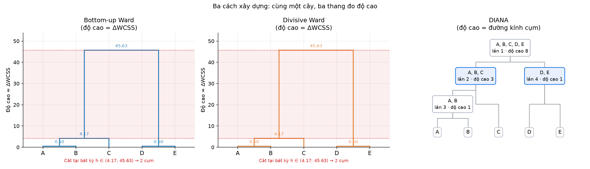

# demoDM — Phân cụm phân cấp (Ward & DIANA)

Bài toán 1 chiều: `A = 1, B = 2, C = 4, D = 8, E = 9`, khoảng cách `d(x, y) = |x - y|`.
Cài đặt từ đầu bằng `numpy` + `matplotlib`, không dùng `scipy`/`sklearn`.

## Notebook

[`ward_clustering_1d.ipynb`](ward_clustering_1d.ipynb)

- **Bottom-up Ward**: gộp dần, in từng bước (ΔWCSS: 0.50 → 0.50 → 4.17 → 45.63).
- **Top-down divisive Ward**: tách dần, duyệt mọi cách chia 2 phần.
- **DIANA**: top-down cổ điển (splinter group, độ cao = đường kính cụm: 8, 3, 1, 1).
- Cắt cây tại `k = 2` → `{A,B,C}` và `{D,E}`; cả ba cách cho cùng cây, WCSS = 5.167 (tối ưu).

## Cấu trúc

| File | Nội dung |
|---|---|
| `ward_clustering_1d.ipynb` | Toàn bộ code, giải thích và hình |
| `THUAT_TOAN.md` | Mô tả chi tiết notebook và 3 thuật toán (Ward 2 hướng, DIANA) |
| `figures/` | Hình xuất ra từ notebook |
| `requirements.txt` | numpy, matplotlib, ipykernel |

## Chạy

```powershell
python -m venv .venv
.\.venv\Scripts\python.exe -m pip install -r requirements.txt
.\.venv\Scripts\python.exe -m jupyter nbconvert --to notebook --execute --inplace ward_clustering_1d.ipynb
```

Hoặc mở `ward_clustering_1d.ipynb` bằng VS Code / Jupyter rồi Run All.


